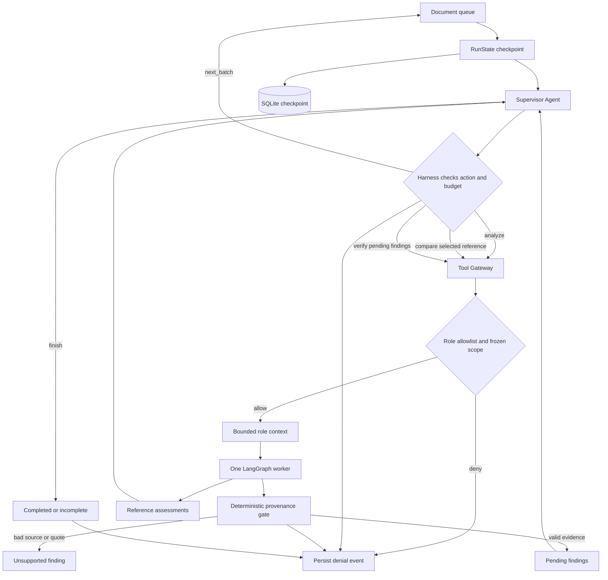

# Paper Review harness

## Harness capabilities

| Capability | Implementation | Visible trace |
| --- | --- | --- |
| Loop | Supervisor action per turn, 20 document batches and 80 turns by default | Decision, batch selection, budget exhausted |
| Tool | `read_chunks`, `search_reference`, `read_rubric` | Tool name, safe source IDs and result |
| Memory | Versioned `RunState` persisted after each turn | Checkpoint event, processed and remaining counts |
| Context | Constructed from permitted tool results, selected rubric and public progress | Context event and included source IDs |
| Permission | Agent allowlist and frozen paper/version scope before data is returned | Allow or deny result |
| Output control | Strict schemas, source identity/version, exact nonempty quote, resolved locator and comparison coverage | Per-finding validation result and reason codes |
| Agent activation | One worker per supervisor turn; comparator only for selected papers; verifier only for pending evidence | Call counts and `agent_skipped` events |

Supervisor is the control agent; the other three are subagents called through the harness. A worker never receives a Groq key, opens a file, or runs a tool directly. In fixture mode, generated output is clearly labeled as a workflow example. In Groq mode, provider JSON structure is checked locally and source provenance is checked independently; a valid quote still does not prove scientific correctness.

For PDF, a locator is a one-based page. For DOCX, it is a one-based nonempty paragraph index. MarkItDown supplies Markdown for model context; independent original-file extraction anchors citations. If conversion text does not map uniquely, the locator stays unresolved and the output gate prevents it from being marked supported.

The run inspector renders persisted events; its diagram reflects actual call counts. It does not invent intermediate agent activity. Failed runs can be inspected, while interrupted runs can be explicitly resumed from their saved state.
