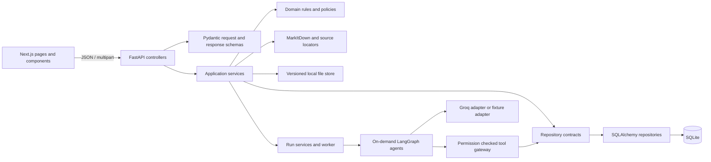
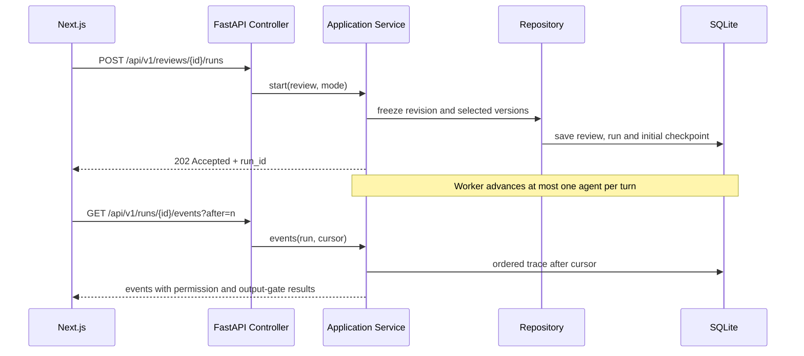

# MVC/MVT, layer boundaries and design patterns

The API uses a model-view-controller arrangement adapted for FastAPI. SQLAlchemy entities are the persistence model, Pydantic schemas define request/response views, and versioned controllers map HTTP methods to application services. The template/view portion is the Next.js interface; it consumes REST resources and owns presentation state. In an MVT interpretation, the same schemas and Next.js pages are the view layer while controllers act as the thin request adapter.

The implementation demonstrates these patterns:

- **MVC/MVT:** controllers map REST requests, services apply use cases, schemas serialize views, SQLAlchemy rows persist data, and Next.js renders the user interface.
- **Repository and Unit of Work:** repository adapters isolate queries; each HTTP use case commits or rolls back as one transaction.
- **Strategy and Adapter:** the harness selects fixture or Groq through one structured-output port; MarkItDown is wrapped behind a conversion adapter.
- **Factory:** `AgentFactory` constructs only the requested LangGraph role graph.
- **State and Command:** `RunState` is the durable state machine; a Supervisor action is a request that the harness validates before executing.
- **Policy / Gateway:** tool allowlists, run scope and approval conditions are checked outside the model.
- **Observer-style event log:** each decision, permission result, gate result and checkpoint is persisted as an ordered event for the inspector.

All routes are rooted at `/api/v1`. Paper versions and rubric criteria versions are immutable snapshots; a run freezes those versions before calling an agent. The domain policies do not trust a support label supplied by a model or client.
